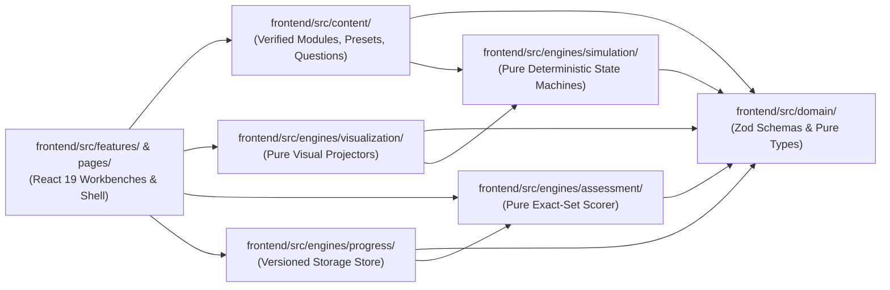

# System & Simulation Architecture — Backend Visual Lab

**Status:** `ACCEPTED`

---

## 1. High-Level Architectural Principles

1. **Simulation Logic MUST Be Independent of Visualization Logic**:
   - All domain state machines live in `frontend/src/engines/simulation/` as pure TypeScript modules with zero React, DOM, XYFlow, or D3 dependencies.
   - Visualization adapters in `frontend/src/engines/visualization/` project a `SimulationStepFrame<TState, TEvent>` into visual nodes, connections, timelines, and inspector tables.
2. **Six Decoupled Platform Engines**:
   1. **Learning Content Engine** (`frontend/src/domain/learning-module.ts` + `frontend/src/content/`): Zod-validated 7-stage modules, source registries, and cross-reference integrity verification.
   2. **Simulation Engine** (`frontend/src/engines/simulation/`): Deterministic state machines, immutable frame history tapes, replay/seek controls, and invariant validators.
   3. **Visualization Engine** (`frontend/src/engines/visualization/`): Pure state-to-visual projectors and accessible SVG/topology workbenches.
   4. **Interactive Playground Engine** (`frontend/src/engines/playground/`): Parameter mutators, preset scenarios, and fault/chaos injection triggers.
   5. **Assessment Engine** (`frontend/src/engines/assessment/`): Deterministic `single-choice` and exact-set `multiple-response` evaluator with immutable attempt history.
   6. **Progress Tracking Engine** (`frontend/src/engines/progress/`): Versioned `localStorage` persistence (`bvl.progress.v1`) with corruption recovery and JSON backup export.
3. **Dual-Mode Execution Model**:
   - **Mode A (Deterministic Browser Simulation — Default)**: Runs 100% in the browser with zero external runtime dependencies.
   - **Mode B (Live Backend Sandbox — Optional)**: Connects to the `Java 21` + `Spring Boot 3.4` Modular Monolith in `backend/` backed by `docker-compose.yml` (PostgreSQL 17, Redis 7.4, Apache Kafka 3.8 KRaft).

---

## 2. Engine Dependency Graph

---

## 3. Simulation Engine State Machine Contract

Every simulation engine implements `SimulationEngineSpec<TConfig, TState, TCommand>` defined in [`frontend/src/engines/simulation/types.ts`](file:///home/anhltn/projects/backend-visual-lab/frontend/src/engines/simulation/types.ts):

- **Deterministic Initialization**: `createInitialFrame(config: TConfig): SimulationStepFrame<TState>`
- **Pure Step Transition**: `applyCommand(currentFrame: SimulationStepFrame<TState>, command: TCommand, config: TConfig): SimulationStepFrame<TState>`
- **Curated Scenario Presets**: Each simulation ships with scripted presets (`presets: SimulationPreset<TConfig, TCommand>[]`) that generate an entire multi-step frame tape (`frames[0..N]`) so learners can immediately press `Play`, `Step Forward`, `Step Back`, or inject ad-hoc commands at any point.
- **Mandatory Fidelity Disclosure (`SimulationFidelityContract`)**:
  - `realWorldReference`: Exact specification / engine version modeled.
  - `accurateBehaviors`: List of faithfully modeled protocol mechanics.
  - `simplifications`: List of educational abstractions.
  - `assumptions`: Explicit environmental assumptions.
  - `unsupportedEdgeCases`: Out-of-scope edge cases.

---

## 4. Backend Modular Monolith Architecture (`backend/`)

The backend is a **Java 21 + Spring Boot 3.4** Modular Monolith (`com.devatlaslab.bvl`) structured by domain package:

- `com.devatlaslab.bvl.shared`: RFC 9457 `ProblemDetail` exception handling, CORS configuration, and generic `SimulationTraceEnvelope` records.
- `com.devatlaslab.bvl.catalog`: REST endpoints (`/api/v1/catalog/domains`, `/api/v1/catalog/status`) exposing domain catalog and live sandbox connectivity status.
- `com.devatlaslab.bvl.messaging`: Kafka sandbox trace endpoints (`/api/v1/labs/kafka/rebalance-preview`) modeling partition assignments (`Range`, `RoundRobin`, `CooperativeSticky`).
- `com.devatlaslab.bvl.caching`: Redis sandbox trace endpoints (`/api/v1/labs/redis/stampede-preview`) modeling TTL expiration and mutex lock stampede prevention.
- `com.devatlaslab.bvl.database`: PostgreSQL sandbox trace endpoints (`/api/v1/labs/postgres/mvcc-preview`) modeling `xmin`/`xmax` tuple visibility and B-Tree vs. Sequential Scan buffer reads.
