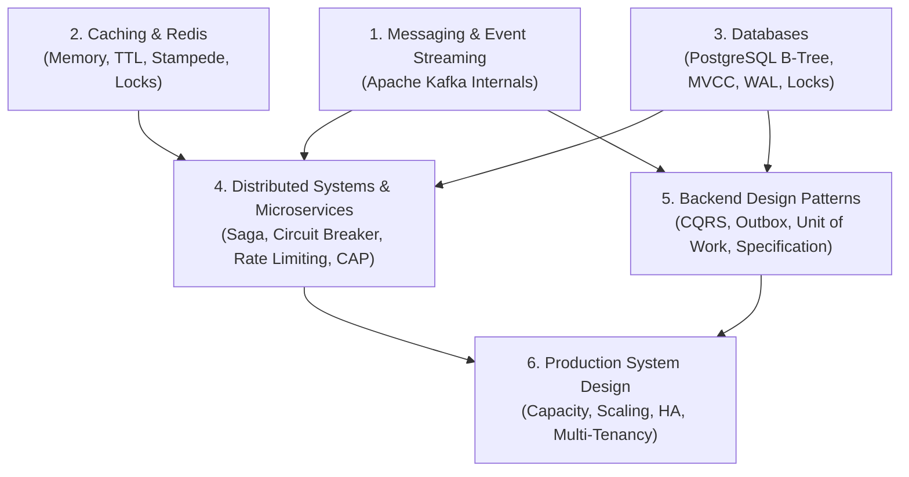

# Learning Paths & Curriculum Blueprint

**Status:** `ACCEPTED`

## 1. Domain Progression Map

## 2. MVP Published & Preview Labs

| Module Slug | Domain | Pedagogical Depth | Interactive Simulation Engine | Status |
| :--- | :--- | :--- | :--- | :--- |
| `kafka-consumer-groups-rebalance` | `messaging` | Full 7-Stage Flagship Module + 6 Scenario Questions | `kafkaConsumerGroupSimulation` (Partitions, Consumers, Assignors, Coordinator State Machine) | `VERIFIED` |
| `redis-cache-stampede-ttl` | `caching` | Full 7-Stage Module + 3 Scenario Questions | `redisStampedeSimulation` (Concurrent Workers, TTL Expiry, Stampede Surge vs. Mutex Lock vs. PER) | `VERIFIED` |
| `postgres-btree-mvcc-visibility` | `databases` | Full 7-Stage Module + 3 Scenario Questions | `postgresMvccBtreeSimulation` (8 KB B-Tree Pages, Heap CTIDs, Visibility Map, `xmin`/`xmax` Snapshots) | `VERIFIED` |
